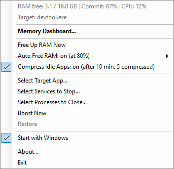
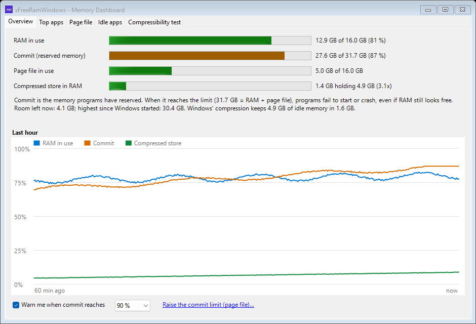
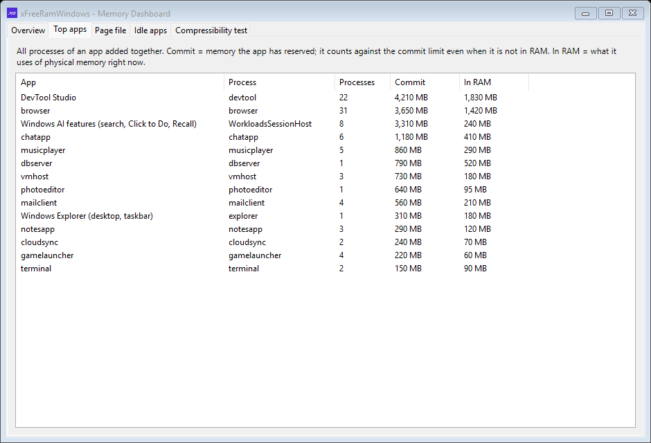
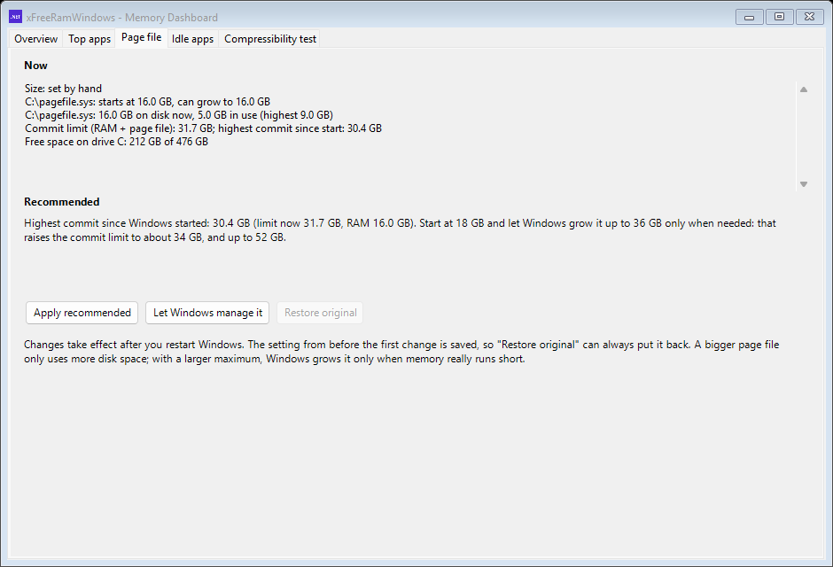
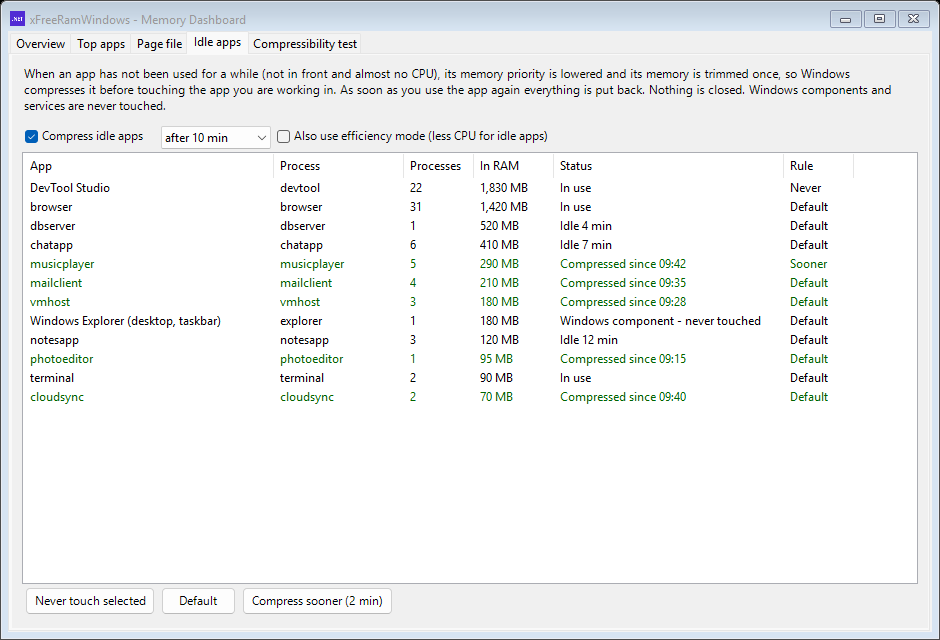
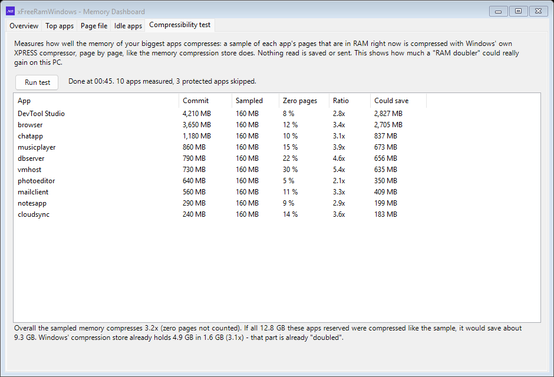
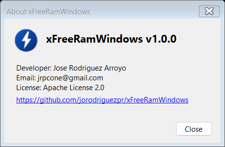

# xFreeRamWindows

A Windows 64-bit tray app that keeps RAM free: it frees memory automatically
when RAM use gets high, and can free up RAM for one target application (e.g.
VS Code) by closing processes and stopping Windows services the user has
explicitly chosen, then restores the stopped services on demand.



## New in 1.2.0: Memory Dashboard

Open it from the tray menu (**Memory Dashboard...**) or by double-clicking the tray icon.



- **Overview**: RAM in use, **commit** (memory programs have reserved), page file
  use and the compressed store, with a graph of the last hour. Commit is the number
  that really runs out: when it reaches the commit limit (RAM + page file), programs
  fail to start or crash even if RAM still looks free.
- **Commit warning** (on by default): a notification when commit reaches 90 %
  (80/85/90/95), at most every 15 minutes, naming the biggest apps. Click it to
  open the page file optimizer.
- **Top apps**: every app's processes added together (VS Code runs ~20), sorted by
  committed memory, with plain names for things like `WorkloadsSessionHost`
  (Windows AI features).
- **Page file optimizer**: shows the current page file and recommends a size from
  the highest commit since Windows started: start at the larger of RAM (up to
  16 GB) and that peak + 10 %; grow up to the larger of 2 x the start and the
  peak + 50 %; never more than 3 x RAM; the drive always keeps max(20 GB, 5 %)
  free. **Apply recommended**, **Let Windows manage it** and **Restore original**
  change the Windows setting through WMI (the documented way), save the original
  setting first, and take effect after a restart.
- **Compress idle apps** (tray menu and Idle apps tab, on by default): when an app
  in your session has not been used for 10 minutes (5/10/15/30/60) - not in front
  and under 1 s of CPU per minute - its memory priority is lowered and its memory
  is trimmed once, so Windows compresses it before the app you are working in.
  As soon as you use it again, everything is put back. Optional efficiency mode
  (EcoQoS). Per-app rules: Never touch / Default / Compress sooner (2 min).
  Windows components, services (other sessions), the Boost target and this app
  are never touched; nothing is closed. Log: `%APPDATA%\xFreeRamWindows\idle.log`.
- **Compressibility test**: reads a sample of each big app's memory pages that
  are in RAM right now (never pages it back in) and compresses each 4 KB page with
  Windows' XPRESS compressor, like the memory compression store does. Shows the
  ratio per app and how much compressing everything could save. Nothing read is
  saved or sent; protected processes are skipped.

| Top apps | Page file |
|---|---|
|  |  |
| **Idle apps** | **Compressibility test** |
|  |  |

_Screenshots use made-up app names and readings._

Run as administrator (the default) to also see how much data Windows' own
compression store holds and its ratio.

Diagnostics (no tray): `xFreeRamWindows.exe --report <file.json> [--compress]`
writes all readings and the page file recommendation; `--screenshots <folder>`
saves each dashboard tab as a PNG.

## How it works

0. **Free Up RAM Now** — always available, no confirmation needed. Trims every
   running process's working set and purges the standby list. Doesn't close
   anything or touch services; just reclaims memory Windows is holding but not
   actively using.
   - **Auto Free RAM** (tray submenu, on by default) runs this same pass by
     itself while the app is running. Every 30 s it checks memory; when RAM in
     use reaches your threshold (60/70/**80**/90 %) it frees RAM, at most once
     per interval (5/**10**/15/30/60 minutes). Safety rules: it never closes
     apps or stops services (that stays the manual, confirmed Boost Now); the
     window you're working in, the Boost target and this app are never
     trimmed; it waits while the CPU is ≥ 90 % busy; and when a run frees under
     100 MB the wait doubles (up to 1 hour), because trimming memory that is
     really in use only makes Windows page it back in. Notifications are off
     by default ("Notify me each time"); every run is written to
     `%APPDATA%\xFreeRamWindows\autofree.log`.
1. Pick a target `.exe` from the tray menu (**Select Target App...**). If it
   isn't already running, Boost launches it.
2. Pick which services Boost Now is allowed to stop (**Select Services to
   Stop...**) — a checklist of every currently-running service (name, service
   name, and publisher, so you can tell Microsoft-published services apart
   from vendor bloat at a glance). Services required for Safe Mode with
   Networking or on the internal protected-list backstop are never shown —
   they can't be selected.

   

3. Pick which processes Boost Now is allowed to close (**Select Processes to
   Close...**) — a checklist of every currently-running process (grouped by
   name, with window title and combined memory usage across instances).
   Protected processes, this app itself, and the selected target app are
   never shown.

   

   Both pickers save your choice to `settings.json`, pre-checked next time you
   open them.
4. **Boost Now**: closes exactly the processes, and stops exactly the
   services, you selected that are currently running (re-verifying all the
   hard-veto guards below at stop/close time regardless of what was
   selected), and records which services it stopped so Restore can undo it.
   Does **not** raise any process's priority, and does **not** touch system
   memory directly (no working-set trim, no standby-list purge) — that's
   `Free Up RAM Now`'s job, kept deliberately separate.
5. **Restore**: restarts every service Boost stopped, with one click. Closed
   processes are not relaunched — that's out of scope by design.
6. The tray icon's tooltip and context menu show live free RAM and an estimated
   CPU% at all times, refreshed every 1.5s — independent of whether Boost is
   active.
7. **About...** shows developer/contact info, license, and a link back to this
   repo.

   

> Screenshots above use fabricated service/process names for illustration —
> not a real machine's data.

## Safety model

- **Services and processes: both fully user-selected, with hard vetoes.** The
  user picks exactly which currently-running services/processes are
  stoppable/closeable; nothing is chosen automatically. For services, two
  checks can never be overridden by that selection: a service required for
  Safe Mode with Networking (read straight from
  `HKLM\SYSTEM\CurrentControlSet\Control\SafeBoot\Minimal` and `\Network` —
  the same registry keys Windows itself populates and consults at boot) or
  on the protected-list backstop is never stopped, and neither ever even
  appears as a selectable option in the picker. If the Safe Mode registry
  keys can't be read or return an implausibly small set, service-stopping is
  skipped entirely for that run rather than falling back to an unsafe
  default. For processes, the protected list, this app's own process, and
  the target app's process are the equivalent hard vetoes and are likewise
  never shown as selectable.
- **Priority-raising: not used by Boost Now** — not part of the current
  design.

This design went through three iterations. Boost Now originally
force-closed every non-protected process and stopped services from either a
blacklist or a hand-curated allowlist; that caused a repeated, identical
full-system bugcheck on real hardware. Cutting Boost Now down to
services-only (no process-closing) stopped the crashes, isolating
process-closing as the actual trigger — but froze very little RAM, since the
services-only version still relied on an automatic classifier (Windows' own
Safe Mode essential list, later narrowed further by a Microsoft-publisher
check) that excluded real memory users like Windows Search/Superfetch along
with the genuinely critical services. Both problems traced back to the same
root cause: an automatic classifier can't tell "safe to stop" from "worth
stopping," and being wrong in either direction is bad — unsafe if it's too
permissive, useless if it's too conservative. Making both processes and
services fully user-selected removes the guesswork entirely: nothing is
closed or stopped unless a person looked at it and chose to, and the process
side reintroduces process-closing in a bounded shape (only what's explicitly
checked) rather than the original unbounded blacklist.

Some selected items may still refuse to stop/close (e.g. a service dependent
on something currently in use, a tamper-protected service like Defender, or
an elevated/system-owned process) — that's expected and shows up as a
skipped item, not an error.

## Requirements

- Windows 10/11 x64
- .NET 10 SDK (only if building from source — the installer and the zip are
  self-contained and need no separate .NET install)
- Must run elevated (the app manifest requests admin) — stopping services and
  closing other users'/elevated processes requires it.

## Install

**Recommended:** download `xFreeRamWindows-Setup-<version>.exe` from the
[Releases](https://github.com/jorodriguezpr/xFreeRamWindows/releases) page and
run it. The setup wizard (English or Spanish) installs to
`C:\Program Files\xFreeRamWindows`, adds a Start Menu shortcut, and optionally
a Desktop shortcut and "Start with Windows". Running Setup again upgrades in
place (it closes xFreeRamWindows first if it is running). Uninstall from
**Settings → Apps → Installed apps** — your settings in
`%APPDATA%\xFreeRamWindows` are kept.

Windows may show "Windows protected your PC" (SmartScreen) because the
installer is not code-signed: click **More info → Run anyway**.

**Portable:** download `xFreeRamWindows-*-win-x64.zip` instead and extract it.

- **Just run it**: run `xFreeRamWindows.exe` directly from the extracted
  folder. Windows will prompt for elevation (UAC) on launch — this is
  required, not optional.
- **Install it with PowerShell**: right-click `install.ps1` → Run with
  PowerShell (or run it from an elevated PowerShell prompt). Copies the app to
  `Program Files\xFreeRamWindows` and adds Start Menu + Desktop shortcuts.
  `uninstall.ps1` removes it again (add `-RemoveConfig` to also delete saved
  service/process selections from `%APPDATA%\xFreeRamWindows`).

## Build from source

```
dotnet build src/xFreeRamWindows/xFreeRamWindows.csproj -c Release
```

Run `src/xFreeRamWindows/bin/Release/net10.0-windows/xFreeRamWindows.exe`.

To build the installer (needs [Inno Setup 6](https://jrsoftware.org/isinfo.php)):

```
powershell -ExecutionPolicy Bypass -File installer/build-installer.ps1
```

It publishes a self-contained win-x64 build and writes
`installer/out/xFreeRamWindows-Setup-<version>.exe`.

## License

Apache License 2.0 — see [LICENSE](LICENSE).
