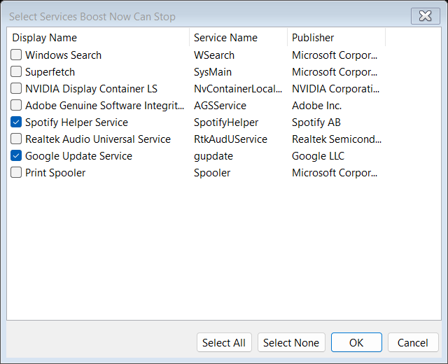
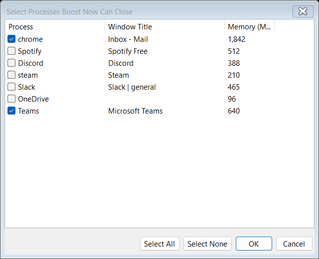

# xFreeRamWindows

A Windows 64-bit tray app that frees up RAM for one target application (e.g.
VS Code) by closing processes and stopping Windows services the user has
explicitly chosen, then restores the stopped services on demand.


## How it works

0. **Free Up RAM Now** — always available, no confirmation needed. Trims every
   running process's working set and purges the standby list. Doesn't close
   anything or touch services; just reclaims memory Windows is holding but not
   actively using.
1. Pick a target `.exe` from the tray menu (**Select Target App...**). If it
   isn't already running, Boost launches it.
2. Pick which services Boost Now is allowed to stop (**Select Services to
   Stop...**) — a checklist of every currently-running service (name, service
   name, and publisher, so you can tell Microsoft-published services apart
   from vendor bloat at a glance). Services required for Safe Mode with
   Networking or on the internal protected-list backstop are never shown —
   they can't be selected.

   

3. Pick which processes Boost Now is allowed to close (**Select Processes to
   Close...**) — a checklist of every currently-running process (grouped by
   name, with window title and combined memory usage across instances).
   Protected processes, this app itself, and the selected target app are
   never shown.

   

   Both pickers save your choice to `settings.json`, pre-checked next time you
   open them.
4. **Boost Now**: closes exactly the processes, and stops exactly the
   services, you selected that are currently running (re-verifying all the
   hard-veto guards below at stop/close time regardless of what was
   selected), and records which services it stopped so Restore can undo it.
   Does **not** raise any process's priority, and does **not** touch system
   memory directly (no working-set trim, no standby-list purge) — that's
   `Free Up RAM Now`'s job, kept deliberately separate.
5. **Restore**: restarts every service Boost stopped, with one click. Closed
   processes are not relaunched — that's out of scope by design.
6. The tray icon's tooltip and context menu show live free RAM and an estimated
   CPU% at all times, refreshed every 1.5s — independent of whether Boost is
   active.

> Screenshots above use fabricated service/process names for illustration —
> not a real machine's data.

## Safety model

- **Services and processes: both fully user-selected, with hard vetoes.** The
  user picks exactly which currently-running services/processes are
  stoppable/closeable; nothing is chosen automatically. For services, two
  checks can never be overridden by that selection: a service required for
  Safe Mode with Networking (read straight from
  `HKLM\SYSTEM\CurrentControlSet\Control\SafeBoot\Minimal` and `\Network` —
  the same registry keys Windows itself populates and consults at boot) or
  on the protected-list backstop is never stopped, and neither ever even
  appears as a selectable option in the picker. If the Safe Mode registry
  keys can't be read or return an implausibly small set, service-stopping is
  skipped entirely for that run rather than falling back to an unsafe
  default. For processes, the protected list, this app's own process, and
  the target app's process are the equivalent hard vetoes and are likewise
  never shown as selectable.
- **Priority-raising: not used by Boost Now** — not part of the current
  design.

This design went through three iterations. Boost Now originally
force-closed every non-protected process and stopped services from either a
blacklist or a hand-curated allowlist; that caused a repeated, identical
full-system bugcheck on real hardware. Cutting Boost Now down to
services-only (no process-closing) stopped the crashes, isolating
process-closing as the actual trigger — but froze very little RAM, since the
services-only version still relied on an automatic classifier (Windows' own
Safe Mode essential list, later narrowed further by a Microsoft-publisher
check) that excluded real memory users like Windows Search/Superfetch along
with the genuinely critical services. Both problems traced back to the same
root cause: an automatic classifier can't tell "safe to stop" from "worth
stopping," and being wrong in either direction is bad — unsafe if it's too
permissive, useless if it's too conservative. Making both processes and
services fully user-selected removes the guesswork entirely: nothing is
closed or stopped unless a person looked at it and chose to, and the process
side reintroduces process-closing in a bounded shape (only what's explicitly
checked) rather than the original unbounded blacklist.

Some selected items may still refuse to stop/close (e.g. a service dependent
on something currently in use, a tamper-protected service like Defender, or
an elevated/system-owned process) — that's expected and shows up as a
skipped item, not an error.

## Requirements

- Windows 11 x64
- .NET 10 SDK (only if building from source — the release download is
  self-contained and needs no separate .NET install)
- Must run elevated (the app manifest requests admin) — stopping services and
  closing other users'/elevated processes requires it.

## Install

Download the latest `xFreeRamWindows-win-x64.zip` from the
[Releases](https://github.com/jorodriguezpr/xFreeRamWindows/releases) page,
extract it anywhere, and run `xFreeRamWindows.exe`. Windows will prompt for
elevation (UAC) on launch — this is required, not optional.

## Build from source

```
dotnet build src/xFreeRamWindows/xFreeRamWindows.csproj -c Release
```

Run `src/xFreeRamWindows/bin/Release/net10.0-windows/xFreeRamWindows.exe`.

## License

Apache License 2.0 — see [LICENSE](LICENSE).
